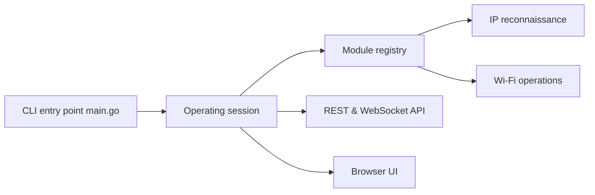

# bettercap/bettercap

> Go framework for analyzing and auditing Ethernet, Wi-Fi, BLE, CAN networks and wireless devices, for authorized security researchers.

## The problem
Auditing a network and its devices requires combining many specialized tools, each with its own interface.

## What it actually does
A Go executable organized into a session and modules. The modules cover host discovery, traffic analysis, Wi-Fi networks, Bluetooth Low Energy devices, the CAN bus and wireless peripherals. Other modules act on the traffic. Extensible in JavaScript, with a REST API, a web interface and script "caplets".

## How it is wired

## Trying it
No command is documented in the provided README; it points to the project documentation.

## Cost and gotchas
Free. It requires system privileges (packet capture, routing, firewall) and sometimes dedicated radio hardware. The provided Dockerfiles ease deployment.

## What it is not
It is not a tool for a network that is not yours: the interception and disruption functions are illegal without the explicit authorization of the owner of the network or devices. The license is present but not identified by GitHub.

## Alternatives
The README names no alternative.

## For you
Worth watching: reserved for auditing a test bench or a network you administer; outside that scope, it has no use for a data/MLOps profile.
