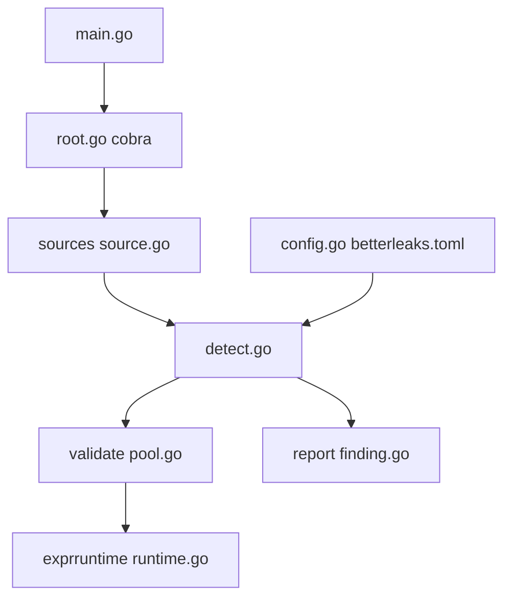

# betterleaks/betterleaks

> Fast, configurable secrets scanner by the Gitleaks team, for repositories, images and platforms.

## The problem
API keys and tokens leak into git history, PRs, buckets or datasets. Regex-based scanners produce many false positives.

## What it actually does
A Go CLI scans files, git history, stdin, GitHub, GitLab, Hugging Face, S3 and container images. Detection combines Aho-Corasick keywords, regex (RE2), decoding and Expr filters, plus a BPE filter against natural text. Optionally (`-v`, `-a`), it validates secrets through HTTP requests written in the rules, then analyzes identity and permissions. Revocation only happens through an explicit command. Outputs: JSON, CSV, SARIF, JUnit. Go SDK provided.

## How it is wired


## Trying it
```bash
brew install betterleaks
docker pull ghcr.io/betterleaks/betterleaks:v2
betterleaks git /path/to/repo
betterleaks fs /path/to/target -v
betterleaks github https://github.com/betterleaks
```

## Cost and gotchas
Free. On the `main` branch (v2), package managers and the Docker `latest` tag may still serve v1 before stable v2. Validation contacts third-party APIs with the secret found. 139 open issues.

## What it is not
Not a remediation tool: it detects, validates, and possibly revokes. The default rules do not replace a config maintained on your side.

## Alternatives
Gitleaks, whose maintainers originated the project (v1 kept on the `v1.x` branch).

## For you
Adopt: a fast secrets scanner, CI-friendly and also scanning Hugging Face, useful for your model and dataset repositories.
