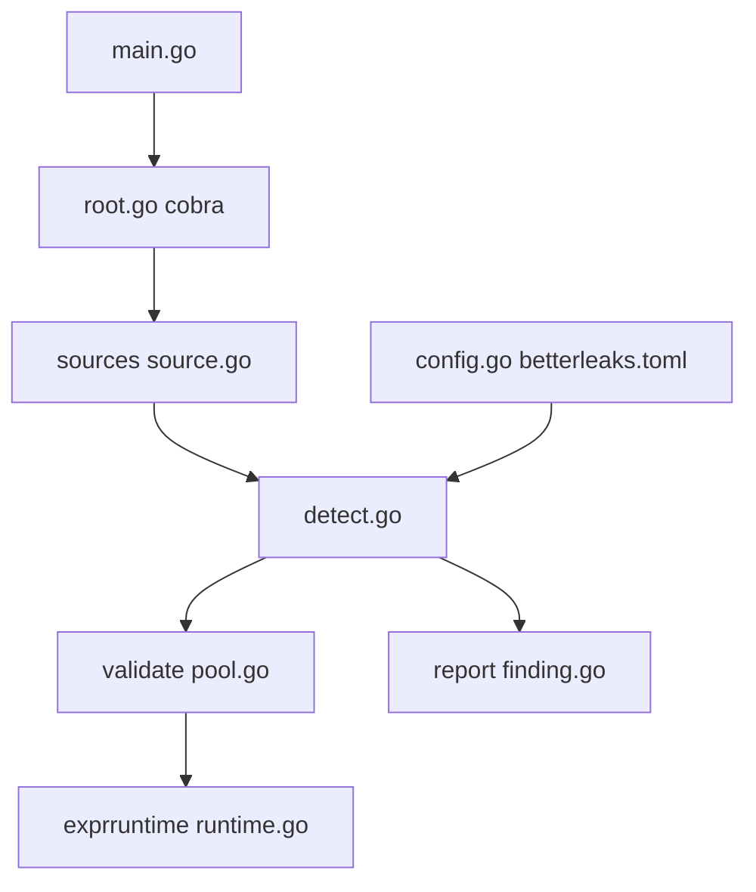

# betterleaks/betterleaks

> Scanner de secrets configurable et rapide, par l'équipe de Gitleaks, pour dépôts, images et plateformes.

## Le problème
Des clés d'API et jetons fuient dans l'historique git, les PR, les buckets ou les datasets. Les scanners à regex produisent beaucoup de faux positifs.

## Ce que ça fait vraiment
Un CLI Go scanne fichiers, historique git, stdin, GitHub, GitLab, Hugging Face, S3 et images de conteneurs. La détection combine mots-clés Aho-Corasick, regex (RE2), décodage et filtres Expr, plus un filtre BPE contre le texte naturel. En option (`-v`, `-a`), il valide les secrets par requêtes HTTP écrites dans les règles, puis analyse identité et permissions. La révocation n'a lieu que par commande explicite. Sorties JSON, CSV, SARIF, JUnit. SDK Go fourni.

## Comment c'est branché


## Essayer
```bash
brew install betterleaks
docker pull ghcr.io/betterleaks/betterleaks:v2
betterleaks git /path/to/repo
betterleaks fs /path/to/target -v
betterleaks github https://github.com/betterleaks
```

## Coût et pièges
Gratuit. Sur la branche `main` (v2), les gestionnaires de paquets et le tag Docker `latest` peuvent encore donner la v1 avant la v2 stable. La validation contacte des API tierces avec le secret trouvé. 139 issues ouvertes.

## Ce que ce n'est pas
Pas un outil de remédiation : il détecte, valide, éventuellement révoque. Les règles par défaut ne remplacent pas une config maintenue chez toi.

## Alternatives
Gitleaks, dont les mainteneurs sont à l'origine du projet (v1 conservée sur la branche `v1.x`).

## Pour toi
À adopter : un scanner de secrets rapide, intégrable en CI et scannant aussi Hugging Face, utile pour tes dépôts de modèles et datasets.

