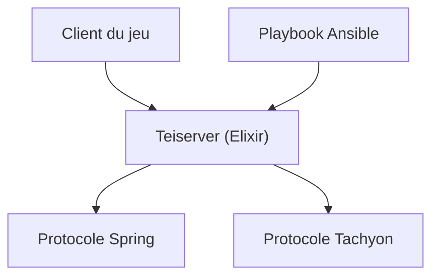

# beyond-all-reason/teiserver

> Elixir intermediary server for the game Beyond All Reason, for its administrators.

## The problem
A multiplayer game needs a lobby server, accounts and matchmaking.

## What it actually does
Elixir server that implements the Spring protocol, with a new Tachyon protocol in progress. Tightly coupled to Beyond All Reason. The README points to guides: local setup, local testing with an Ansible playbook, production with Ansible, architecture.

## How it is wired
Simplified diagram based on the card, no diagram provided.



## Trying it
```bash
# aucune commande dans le README : voir les guides Local setup et Prod setup
```

## Cost and gotchas
Free. The Docker prerequisite is inferred from the test playbook and not written in the README. Strong coupling to the game.

## What it is not
Not a generic game server, despite the invitation to use it elsewhere: the README warns that it remains tied to BAR.

## Alternatives
No alternative named in the README.

## For you
Ignore: Elixir game infrastructure unrelated to your data / AI work.
