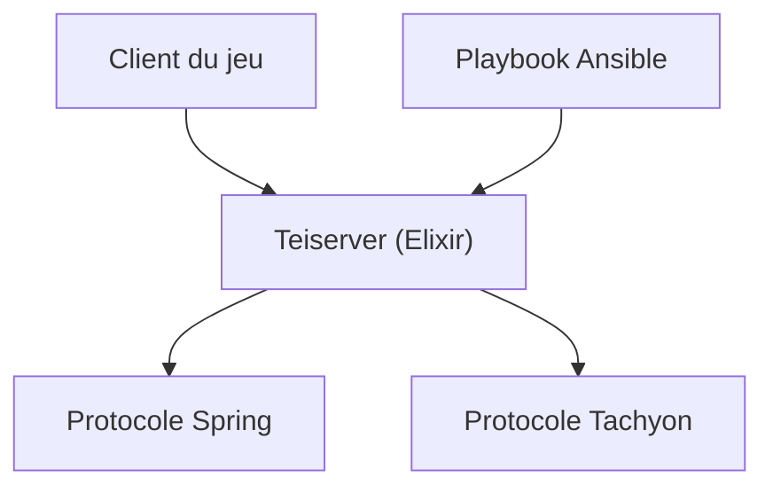

# beyond-all-reason/teiserver

> Serveur intermédiaire Elixir pour le jeu Beyond All Reason, pour ses administrateurs.

## Le problème
Un jeu multijoueur a besoin d'un serveur de lobby, de comptes et de matchmaking.

## Ce que ça fait vraiment
Serveur Elixir qui implémente le protocole Spring, avec un nouveau protocole Tachyon en cours. Fortement couplé à Beyond All Reason. Le README renvoie à des guides : installation locale, tests locaux par playbook Ansible, production par Ansible, architecture.

## Comment c'est branché
Schéma simplifié d'après la fiche, sans diagramme fourni.



## Essayer
```bash
# aucune commande dans le README : voir les guides Local setup et Prod setup
```

## Coût et pièges
Gratuit. Le prérequis Docker est une déduction du playbook de test, non écrit dans le README. Couplage fort au jeu.

## Ce que ce n'est pas
Pas un serveur de jeu générique, malgré l'invitation à l'utiliser ailleurs : le README prévient qu'il reste lié à BAR.

## Alternatives
Aucune alternative nommée dans le README.

## Pour toi
Ignorer : infrastructure de jeu en Elixir sans lien avec ton métier data / IA.

