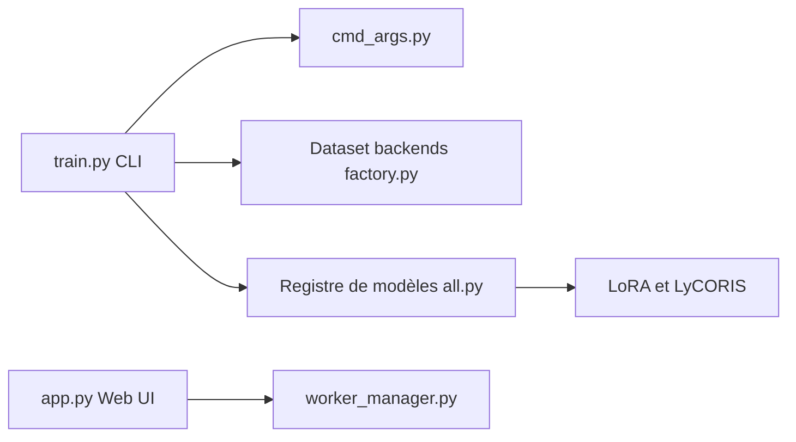

# bghira/SimpleTuner

> Toolkit for training or fine-tuning image, video and audio diffusion models, via CLI or web interface.

## The problem
Fine-tuning a diffusion model (LoRA, full-scale) involves pipelines scattered per architecture, memory problems and little team tracking.

## What it actually does
A unified trainer for many models (Flux, SDXL, SD3, Wan, LTX Video, Qwen Image, ACE-Step…), with embedding cache, aspect bucketing, DeepSpeed and FSDP2, EMA, training from S3. A web interface and a multi-user platform: GPU worker orchestration, SSO, roles, quotas, approvals and audit. According to the README, no data is sent to third parties apart from options you have to enable (`report_to`, `push_to_hub`, webhooks).

## How it is wired


## Trying it
```bash
pip install simpletuner
pip install 'simpletuner[cuda]'
pip install 'simpletuner[rocm]' --extra-index-url https://download.pytorch.org/whl/rocm7.1
pip install 'simpletuner[apple]'
```

## Cost and gotchas
GPU required: RTX 3080+ recommended (NVIDIA), 24 GB for most models in LoRA, A100 80 GB for the largest in full-scale. AMD and Apple support is more limited in memory.

## What it is not
Not an image generator: it prepares models. AGPL-3.0 license, to be examined for use in a service. The per-model getting-started guides are separate documents.

## Alternatives
No alternative named in the README.

## For you
Adopt it if you fine-tune generative models: broad model coverage, memory options and team tracking already built in, provided you accept the AGPL.
