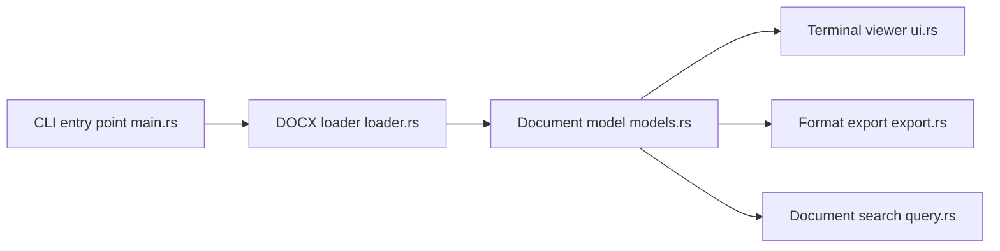

# bgreenwell/doxx

> Terminal viewer for .docx files, with search and export, no Word needed.

## The problem
Reading or extracting a .docx in a terminal loses formatting and tables with docx2txt or pandoc.

## What it actually does
Terminal interface (ratatui) with headings, lists, tables and LaTeX equations, search, clipboard copy, inline images. Export to Markdown, CSV (tables only), JSON, text or ANSI. TOML configuration file with default, vim and less key profiles.

## How it is wired


## Trying it
```bash
brew install bgreenwell/tap/doxx
doxx report.docx
doxx contract.docx --search "payment"
doxx data.docx --export csv > data.csv
doxx report.docx --export markdown > report.md
```

## Cost and gotchas
Free. Libxcb required on Linux to build. The Scoop entry is marked "coming soon".

## What it is not
Not an editor: read and export only, .docx only. The position of displayed equations may be imprecise (a known limitation of docx-rs).

## Alternatives
docx2txt, pandoc and antiword (cited in the README as less suitable).

## For you
Worth watching: handy for extracting tables and text from .docx in a script before analysis, but pandoc is often enough already.
