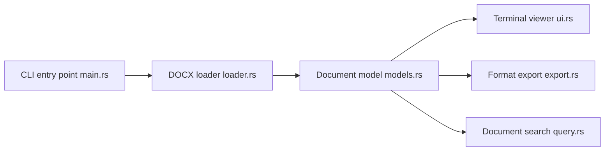

# bgreenwell/doxx

> Visionneuse de fichiers .docx dans le terminal, avec recherche et export, sans Word.

## Le problème
Lire ou extraire un .docx en terminal perd la mise en forme et les tableaux avec docx2txt ou pandoc.

## Ce que ça fait vraiment
Interface terminal (ratatui) avec titres, listes, tableaux et équations LaTeX, recherche, copie presse-papiers, images en ligne. Export en Markdown, CSV (tableaux seuls), JSON, texte ou ANSI. Fichier de configuration TOML avec profils de touches default, vim et less.

## Comment c'est branché


## Essayer
```bash
brew install bgreenwell/tap/doxx
doxx report.docx
doxx contract.docx --search "payment"
doxx data.docx --export csv > data.csv
doxx report.docx --export markdown > report.md
```

## Coût et pièges
Gratuit. Libxcb requis sous Linux pour compiler. L'entrée Scoop est marquée « bientôt ».

## Ce que ce n'est pas
Pas un éditeur : lecture et export seulement, .docx uniquement. La position des équations affichées peut être imprécise (limite connue de docx-rs).

## Alternatives
docx2txt, pandoc et antiword (cités dans le README comme moins adaptés).

## Pour toi
À surveiller : pratique pour extraire tableaux et texte de .docx en script avant analyse, mais pandoc suffit souvent déjà.

