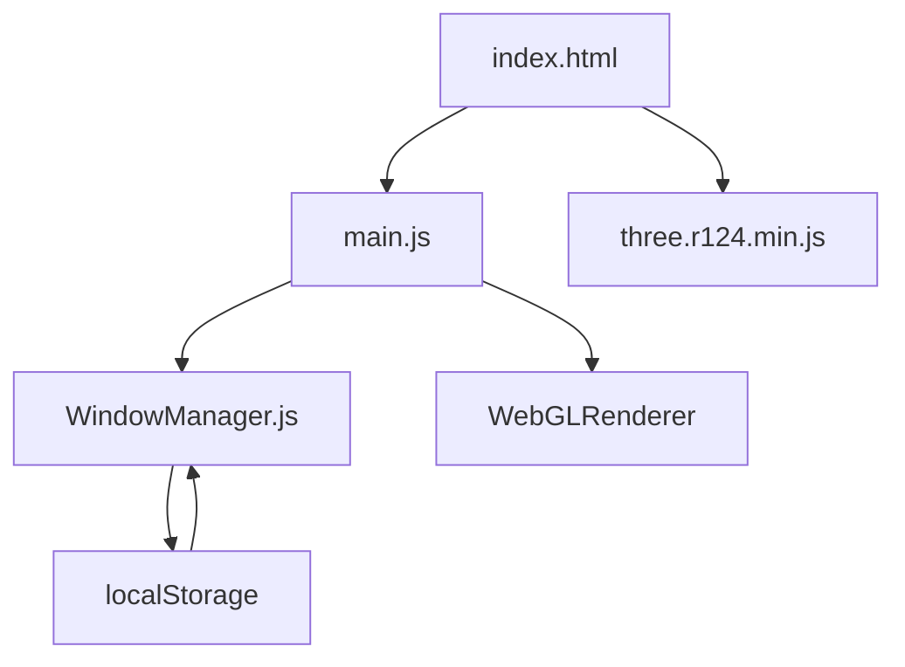

# bgstaal/multipleWindow3dScene

> Three.js demo of a 3D scene shared across several browser windows via localStorage.

## The problem
Coordinating the state of several windows of the same browser, without a server, is poorly documented.

## What it actually does
Each window runs the same `index.html` page with Three.js r124. `WindowManager.js` records the windows' state in `localStorage` and reacts to `storage` events; `main.js` initializes the scene and updates the rendering according to the windows' positions. No backend.

## How it is wired


## Trying it
```bash
git clone https://github.com/bgstaal/multipleWindow3dScene
```
Then open `index.html` in the browser.

## Cost and gotchas
Free. The last push dates from 2023; Three.js is frozen at r124.

## What it is not
It is not a reusable library nor a published module: it is a demonstration.

## Alternatives
The README cites none.

## For you
Ignore: graphics demo unrelated to data, AI or MLOps; interesting only as a front-end curiosity.
