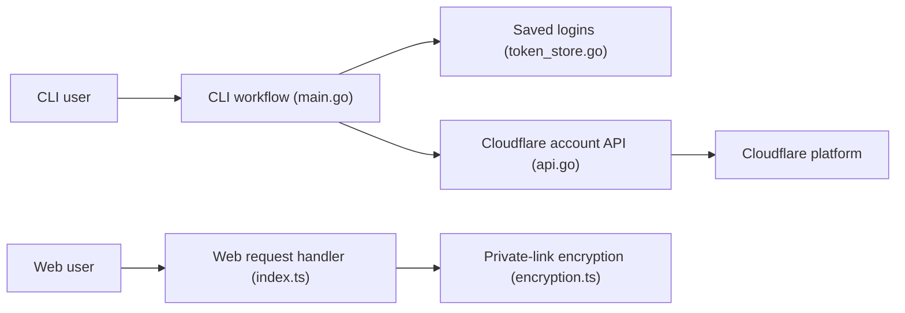

# bia-pain-bache/BPB-Wizard

> Setup assistant for installing "BPB Panel" on a Cloudflare account, as a web version or a command-line version.

## The problem
Deploying BPB Panel by hand on Cloudflare (Workers or Pages, KV namespace) is prone to configuration errors.

## What it actually does
Collects the Cloudflare credentials, chooses Workers or Pages, creates a KV namespace, generates the panel script, deploys it and returns the URL. The CLI edition (Go) remembers several accounts; the web edition (TypeScript) produces an encrypted "private link" to reinstall in one click. What BPB Panel itself does is not described in this README.

## How it is wired


## Trying it
```bash
bash <(curl -fsSL https://raw.githubusercontent.com/bia-pain-bache/BPB-Wizard/main/install.sh)
```
Windows: `irm https://raw.githubusercontent.com/bia-pain-bache/BPB-Wizard/main/install.ps1 | iex`.

## Cost and gotchas
Free on the tool side, but it requires a Cloudflare account and its token, stored on your machine (CLI). Installation via `curl | bash` or `irm | iex`. On Android, Termux must come from GitHub.

## What it is not
Not the final application: it only installs an external panel about which the README says nothing. Very short README, limited material.

## Alternatives
No alternative named in the README.

## For you
Ignore: depends entirely on an undescribed third-party panel and asks for your Cloudflare access, unrelated to data/AI/MLOps.
