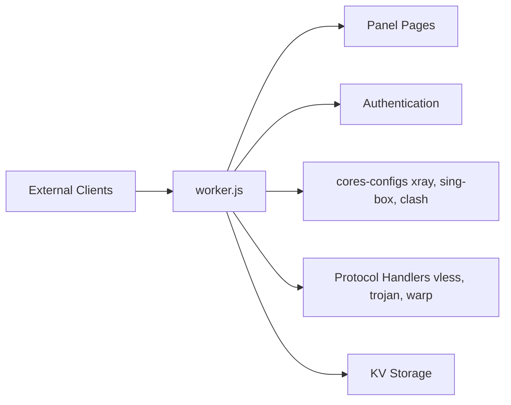

# bia-pain-bache/BPB-Worker-Panel

> Web panel on Cloudflare Workers to generate VLESS, Trojan and Warp proxy configurations.

## The problem
Users whose domains or services are blocked by their ISP are looking for a private proxy to deploy themselves.

## What it actually does
A Worker (or Pages) script runs a password-protected panel and generates subscriptions for the Xray, Sing-box and Clash-Mihomo clients. Supports VLESS, Trojan, Warp, a private DoH, fragmentation, routing rules and chained proxies. The configuration is stored in Cloudflare KV.

## How it is wired

## Trying it
The README contains no command: it points to the installation pages (BPB Wizard) and the FAQ.

## Cost and gotchas
Free but depends on a Cloudflare account. Limit of 100K requests per day per worker (VLESS/Trojan), for 2 to 3 users. UDP poorly handled. The README asks for donations in USDT.

## What it is not
Not a commercial VPN: it is a network-block workaround hosted on a third-party platform.

## Alternatives
No alternative cited in the README.

## For you
Ignore: a network-circumvention tool with no data/AI use; it depends on Cloudflare and could violate its terms.
