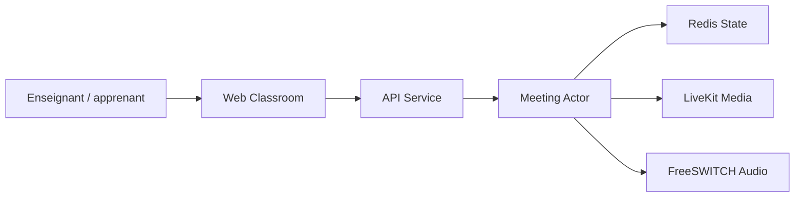

# bigbluebutton/bigbluebutton

> Open source virtual classroom: audio, video, annotated slides, chat and screen sharing for remote teaching.

## The problem
Teaching remotely requires video conferencing, a whiteboard, polls, breakout rooms and recording, all combined in one tool.

## What it actually does
Real-time sharing of audio, video, slides, chat and screen; polls, shared notes, breakout rooms, recording, an analytics dashboard. According to the architecture described: an API and session service, meeting actors in Scala (users, chat, voice), state in Redis, presentation conversion, LiveKit for media and FreeSWITCH for audio, and a React web client.

## How it is wired

## Trying it
The README gives no command: it mentions the `bbb-install.sh` script on Ubuntu 22.04 and points to the official documentation. No command reproduced.

## Cost and gotchas
Free, but must be hosted on a dedicated Ubuntu 22.04 server with bandwidth. 725 open issues. LGPL-3.0 license.

## What it is not
It is not a simple lightweight video conferencing tool: it is a platform to deploy and operate. The name BigBlueButton is a registered trademark.

## Alternatives
No alternative named in the README.

## For you
Ignore: a teaching platform to operate, unrelated to a data/AI workflow, unless you have a specific need for a self-hosted virtual classroom.
