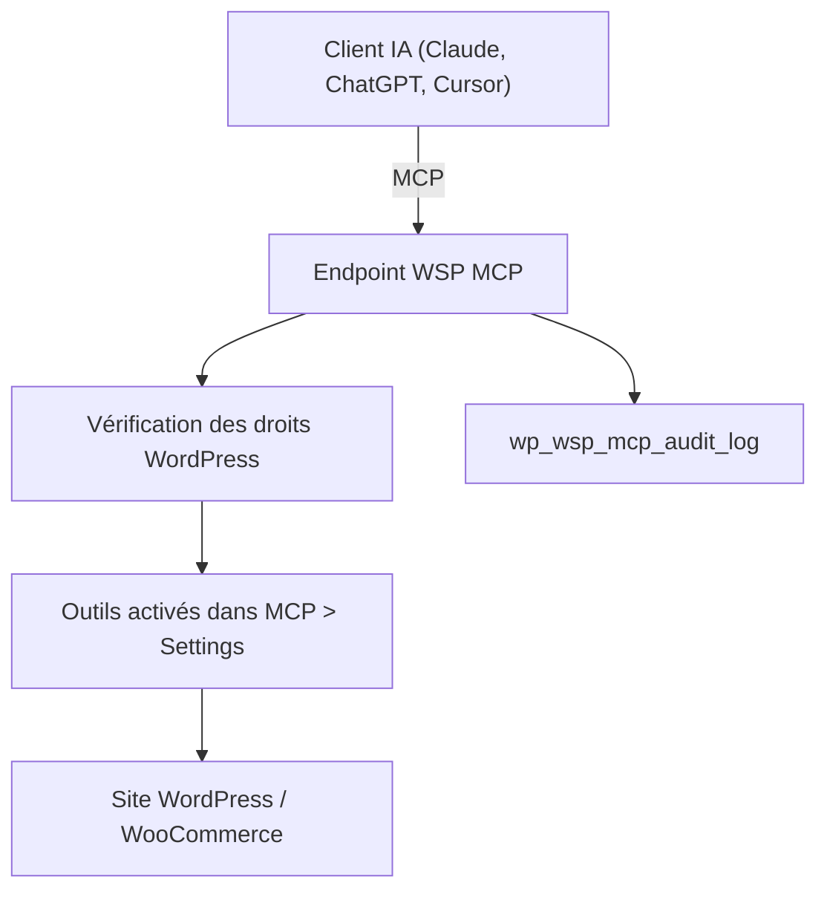

# bilalnaseer/wsp-wordpress-mcp

> Free WordPress plugin that exposes the site to Claude, ChatGPT or Cursor via MCP, to manage content and shop.

## The problem
Driving a WordPress site from an AI agent normally requires an MCP adapter and a lot of configuration.

## What it actually does
The plugin adds an MCP server with more than 200 tools: posts, pages, media, menus, users, WooCommerce, Yoast, Elementor, ACF and forms. Write tools are disabled by default, each tool has its own switch, and the agent acts with the rights of its WordPress user. An audit log is stored in the site's database.

## How it is wired
Simplified diagram based on the sheet, no diagram provided.

## Trying it
No documented command: installation is done in wp-admin (MCP > Settings then MCP > Connection).

## Cost and gotchas
Requires WordPress 6.9+ and PHP 7.4+. Node.js 18+ is only required for the mcp-remote bridge for Claude Desktop and OpenClaw. The README reported an authorization flaw fixed in v2.9.6: keep updates current. Write tools give the agent real power.

## What it is not
It is not an MCP client nor a tool independent of WordPress. The repository also serves as a showcase for the WebSensePro agency, with a lot of promotion.

## Alternatives
- No alternative named in the README.

## For you
Worth watching: interesting if you want to automate a WordPress site with an agent; test first on a development site given the write permissions.
