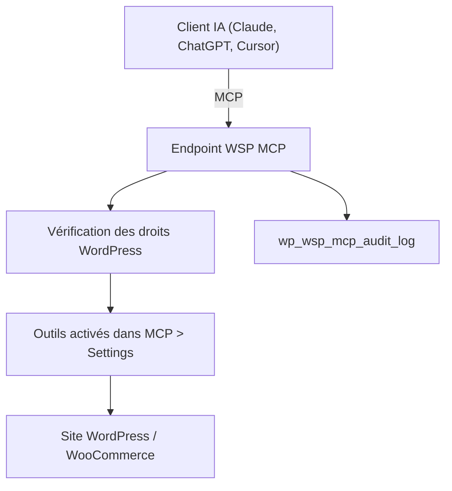

# bilalnaseer/wsp-wordpress-mcp

> Plugin WordPress gratuit qui expose le site à Claude, ChatGPT ou Cursor via MCP, pour gérer contenu et boutique.

## Le problème
Piloter un site WordPress depuis un agent IA demande normalement un adaptateur MCP et beaucoup de réglages.

## Ce que ça fait vraiment
Le plugin ajoute un serveur MCP avec plus de 200 outils : articles, pages, médias, menus, utilisateurs, WooCommerce, Yoast, Elementor, ACF et formulaires. Les outils d'écriture sont désactivés par défaut, chaque outil a son interrupteur et l'agent agit avec les droits de son utilisateur WordPress. Un journal d'audit est stocké dans la base du site.

## Comment c'est branché
Schéma simplifié d'après la fiche, sans diagramme fourni.

## Essayer
Aucune commande documentée : l'installation se fait dans wp-admin (MCP > Settings puis MCP > Connection).

## Coût et pièges
Il faut WordPress 6.9+ et PHP 7.4+. Node.js 18+ n'est requis que pour le pont mcp-remote de Claude Desktop et OpenClaw. Le README a signalé une faille d'autorisation corrigée en v2.9.6 : garde les mises à jour à jour. Les outils d'écriture donnent de vrais pouvoirs à l'agent.

## Ce que ce n'est pas
Ce n'est pas un client MCP ni un outil indépendant de WordPress. Le dépôt sert aussi de vitrine à l'agence WebSensePro, avec beaucoup de promotion.

## Alternatives
- Aucune alternative nommée dans le README.

## Pour toi
À surveiller : intéressant si tu veux automatiser un site WordPress avec un agent, à tester d'abord sur un site de développement vu les droits d'écriture.

