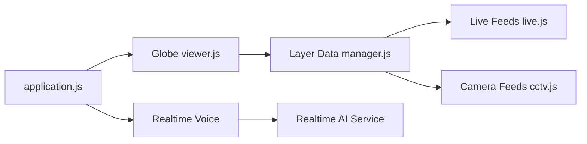

# bilawalsidhu/gods-eye-view

> A 3D globe in the browser that overlays aircraft, ships, satellites and public cameras, with optional voice control.

## The problem
Public signals (flights, AIS, orbits, earthquakes, cameras) are scattered; cross-referencing them on an explorable map takes a lot of assembly.

## What it actually does
A CesiumJS client in framework-free JavaScript, served by Vite, with one module per data layer. Fifteen layers, thirteen of them keyless. Voice goes through the OpenAI Realtime API (28 tools), via a server-side proxy that keeps the keys. Simulated traffic, camera poses and rocket trajectories are estimates.

## How it is wired


## Trying it
```bash
git clone https://github.com/bilawalsidhu/gods-eye-view.git
cd gods-eye-view
npm ci
npm run doctor
npm run dev
```
Then open `http://localhost:4173`.

## Cost and gotchas
Starts without a key. Voice requires a paid OpenAI key ($5 cap per session in the app). Direct Google 3D is billed; Cesium ion is free for personal non-commercial use. Node 24.14 or 26.

## What it is not
Not an operational tool: the README forbids use for navigation, emergencies and critical decisions, since data may be delayed or wrong. License not identified by GitHub (the README cites MIT).

## Alternatives
No alternative named in the README.

## For you
Keep an eye on it: a good example of fusing real-time feeds with a voice agent, but 201 open issues, a repository born in June 2026 and a license to confirm before any reuse.
