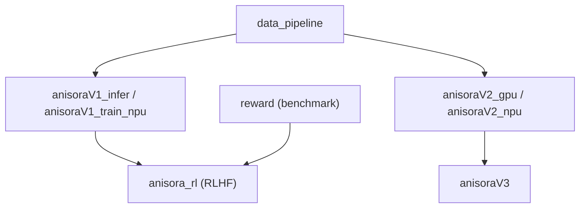

# bilibili/Index-anisora

> Open-source anime video generation models, with training and inference code.

## The problem
General-purpose video models handle animation styles, exaggerated motion and character consistency poorly.

## What it actually does
Repository with several versions: V1 (CogVideoX-5B base, runs on an RTX 4090), V2 (Wan2.1-14B base, with a Huawei Ascend 910B NPU version), V3 (3D character rotation, style transfer, 90p to 1080p super-resolution). Adds a data-cleaning pipeline, a 948-clip benchmark and an RLHF framework.

## How it is wired
No diagram; folders cited by the README.

## Trying it
No command documented in the README excerpt: it points to the `anisoraV1_infer`, `anisoraV2_gpu`, `anisoraV3` folders.

## Cost and gotchas
Heavy GPU (4090 for V1, more for V2 14B). Access to the benchmark goes through a hand-signed form sent by e-mail.

## What it is not
Not an online service nor a turnkey tool: it is a research repository. The README presents itself as "the most powerful" without comparable proof; the tables show that Wan-2.1 or MiniMax do better on some criteria.

## Alternatives
Wan2.1 and CogVideoX (project bases), Vidu, MiniMax (compared in the table).

## For you
Keep an eye on it: interesting for anime video and evaluation data, but no clear start command in the README and demanding on GPU.
