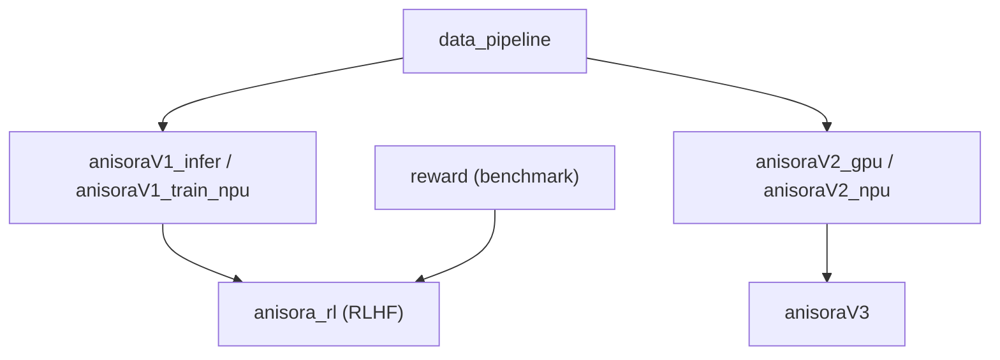

# bilibili/Index-anisora

> Modèles open source de génération vidéo d'animation (anime), avec code d'entraînement et d'inférence.

## Le problème
Les modèles vidéo généralistes gèrent mal les styles d'animation, les mouvements exagérés et la cohérence des personnages.

## Ce que ça fait vraiment
Dépôt de plusieurs versions : V1 (base CogVideoX-5B, tourne sur RTX 4090), V2 (base Wan2.1-14B, avec version NPU Huawei Ascend 910B), V3 (rotation 3D de personnage, transfert de style, super-résolution 90p vers 1080p). Ajoute un pipeline de nettoyage de données, un benchmark de 948 clips et un cadre RLHF.

## Comment c'est branché
Pas de diagramme ; dossiers cités par le README.

## Essayer
Aucune commande documentée dans l'extrait du README : il renvoie aux dossiers `anisoraV1_infer`, `anisoraV2_gpu`, `anisoraV3`.

## Coût et pièges
GPU lourd (4090 pour V1, davantage pour V2 14B). L'accès au benchmark passe par un formulaire signé à la main envoyé par courriel.

## Ce que ce n'est pas
Pas un service en ligne ni un outil clé en main : c'est un dépôt de recherche. Le README se présente comme « le plus puissant » sans preuve comparable ; les tableaux montrent que Wan-2.1 ou MiniMax font mieux sur certains critères.

## Alternatives
Wan2.1 et CogVideoX (bases du projet), Vidu, MiniMax (comparés dans le tableau).

## Pour toi
Surveiller : intéressant pour la vidéo anime et les données d'évaluation, mais sans commande de démarrage claire dans le README et demandeur en GPU.

