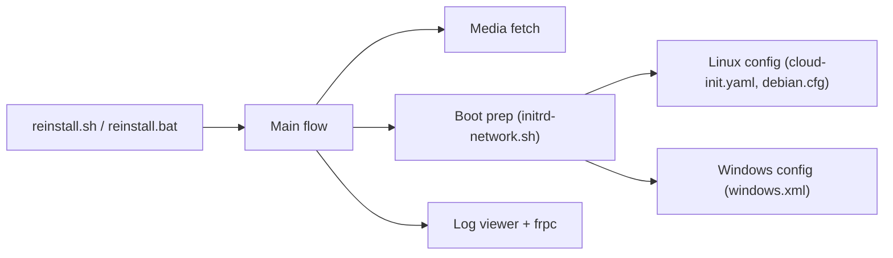

# bin456789/reinstall

> Script that reinstalls a VPS or server with Linux or Windows in one command, for administrators.

## The problem
Changing the OS of a VPS when the provider does not offer the right system, or without IPMI access or a USB stick.

## What it actually does
`reinstall.sh` (Linux) and `reinstall.bat` (Windows) analyze the target, download the images, generate the network and disk configuration, prepare a temporary boot environment, then reboot into it. Modes: Linux installation (20 distributions), raw image DD, Alpine Live OS, netboot.xyz, Windows from an official ISO with driver injection. A web log viewer and an frpc tunnel make remote monitoring easier.

## How it is wired


## Trying it
```bash
curl -O https://raw.githubusercontent.com/bin456789/reinstall/main/reinstall.sh
bash reinstall.sh debian 13
bash reinstall.sh reset    # annuler avant le redémarrage
```

## Cost and gotchas
Free. Wipes the entire disk, other partitions included. OpenVZ and LXC are not supported. The README is in Chinese (an English version is linked).

## What it is not
Not a backup or migration tool: it destroys data. It does not update the new system. For a physical server, the README advises against using it if IPMI or USB are available.

## Alternatives
No alternative named in the README.

## For you
Worth watching: handy to recycle a test or compute VPS, but destructive and maintained by a single person.
