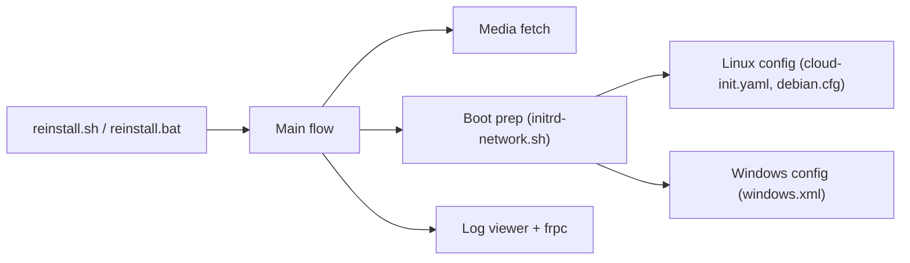

# bin456789/reinstall

> Script qui réinstalle un VPS ou un serveur sous Linux ou Windows en une commande, pour administrateurs.

## Le problème
Changer l'OS d'un VPS quand le fournisseur ne propose pas le bon système, ou sans accès IPMI ni clé USB.

## Ce que ça fait vraiment
`reinstall.sh` (Linux) et `reinstall.bat` (Windows) analysent la cible, téléchargent les images, génèrent la configuration réseau et disque, préparent un environnement de boot temporaire puis redémarrent dedans. Modes : installation Linux (20 distributions), DD d'image raw, Alpine Live OS, netboot.xyz, Windows depuis ISO officiel avec injection de pilotes. Un log viewer web et un tunnel frpc facilitent le suivi à distance.

## Comment c'est branché


## Essayer
```bash
curl -O https://raw.githubusercontent.com/bin456789/reinstall/main/reinstall.sh
bash reinstall.sh debian 13
bash reinstall.sh reset    # annuler avant le redémarrage
```

## Coût et pièges
Gratuit. Efface tout le disque, autres partitions comprises. OpenVZ et LXC ne sont pas gérés. Le README est en chinois (une version anglaise est liée).

## Ce que ce n'est pas
Pas un outil de sauvegarde ni de migration : il détruit les données. Il ne met pas à jour le nouveau système. Pour un serveur physique, le README déconseille de l'utiliser si IPMI ou USB sont disponibles.

## Alternatives
Aucune alternative nommée dans le README.

## Pour toi
À surveiller : pratique pour recycler un VPS de test ou de calcul, mais destructeur et tenu par une seule personne.

