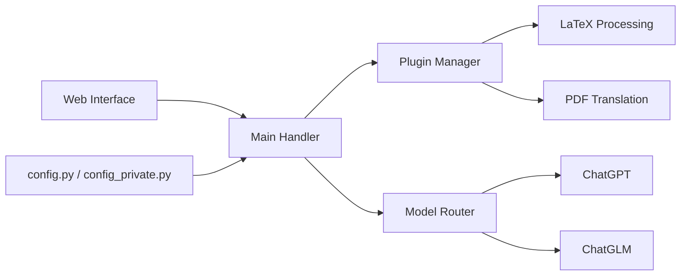

# binary-husky/gpt_academic

> Chinese Gradio interface of LLM tools for research: translate, proofread and summarize papers.

## The problem
Translating an arXiv paper, correcting LaTeX or summarizing a PDF with an LLM requires tedious copy-pasting and formatting to redo.

## What it actually does
A web interface where each button is a function or a plugin (generated from `functional.py`): fine-grained translation of arXiv papers (Docker), LaTeX translation and proofreading, PDF translation, paper summaries, code project analysis, batch comments, voice conversation.
Several LLMs at once: OpenAI, Qwen, GLM, DeepSeek, local ChatGLM/MOSS. Configuration through `config.py`, overridden by `config_private.py`, then by environment variables.

## How it is wired


## Trying it
```bash
git clone --depth=1 https://github.com/binary-husky/gpt_academic.git
cd gpt_academic
python -m pip install -r requirements.txt
```
The launch command is not in the part of the README that was read.

## Cost and gotchas
API keys on you (several accepted at once); local models (ChatGLM4: 24 GB of VRAM) require a GPU. GPL-3.0 license.

## What it is not
Not a library: the `void-terminal` package for calling it from Python is "under development". Interface and documentation mostly in Chinese; several models cited (MOSS, Newbing) are outdated.

## Alternatives
No alternative named in the README.

## For you
To ignore: Claude Code or your own skills cover paper translation and proofreading with fewer dependencies.
