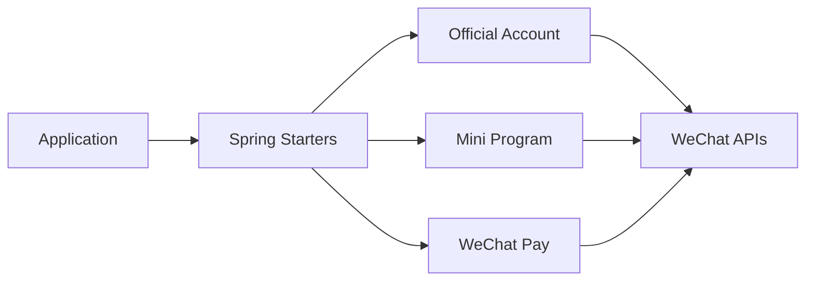

# binarywang/WxJava

> Server-side Java SDK for the WeChat APIs: payment, official accounts, mini programs, WeCom.

## The problem
Calling the WeChat APIs (payment, OAuth, messages) by hand in Java is slow and error-prone.

## What it actually does
Maven modules per scenario: `weixin-java-mp` (official account), `-miniapp`, `-pay`, `-cp` (WeCom), `-open` (third-party platform), `-channel` (videos and shop). It provides Spring starters and Solon plugins, a version BOM and "skills" for coding agents (module choice, integration, troubleshooting). It is server-side only: the mobile app keeps the official WeChat SDK.

## How it is wired


## Trying it
```bash
git clone https://github.com/binarywang/WxJava.git
mkdir -p "${CODEX_HOME:-$HOME/.codex}/skills"
cp -R WxJava/skills/wxjava-* "${CODEX_HOME:-$HOME/.codex}/skills/"
```
(These commands install the skills for agents; normal use goes through a Maven dependency.)

## Cost and gotchas
Free, but you need WeChat developer accounts and an AppID/secret. The README is in Chinese; JDK 8 minimum; code based on Lombok.

## What it is not
Not a web application or a mobile client. Nothing to do with AI, apart from the integration-helper skills.

## Alternatives
No alternative cited in the README.

## For you
Ignore unless you have a WeChat integration project in Java: outside the data, AI and MLOps scope.
