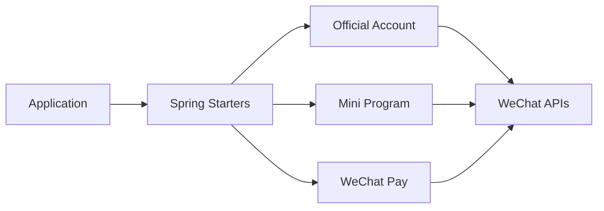

# binarywang/WxJava

> SDK Java côté serveur pour les API WeChat : paiement, comptes officiels, mini-programmes, WeCom.

## Le problème
Appeler les API WeChat (paiement, OAuth, messages) à la main en Java est long et sujet aux erreurs.

## Ce que ça fait vraiment
Modules Maven par scénario : `weixin-java-mp` (compte officiel), `-miniapp`, `-pay`, `-cp` (WeCom), `-open` (plateforme tierce), `-channel` (vidéos et boutique). Il fournit des starters Spring et des plugins Solon, un BOM de versions et des « skills » pour agents de code (choix de module, intégration, dépannage). Il est côté serveur uniquement : l'app mobile garde le SDK officiel WeChat.

## Comment c'est branché


## Essayer
```bash
git clone https://github.com/binarywang/WxJava.git
mkdir -p "${CODEX_HOME:-$HOME/.codex}/skills"
cp -R WxJava/skills/wxjava-* "${CODEX_HOME:-$HOME/.codex}/skills/"
```
(Ces commandes installent les skills pour agents ; l'usage normal passe par une dépendance Maven.)

## Coût et pièges
Gratuit, mais il faut des comptes WeChat développeur et un AppID/secret. README en chinois ; JDK 8 minimum ; code basé sur Lombok.

## Ce que ce n'est pas
Pas une application web ni un client mobile. Rien à voir avec l'IA, hormis les skills d'aide à l'intégration.

## Alternatives
Aucune alternative citée dans le README.

## Pour toi
À ignorer sauf projet d'intégration WeChat en Java : hors du périmètre data, IA et MLOps.

