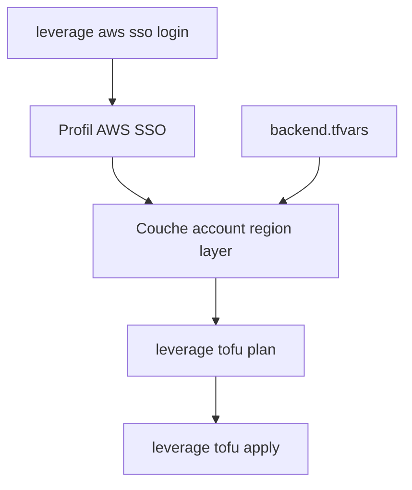

# binbashar/le-tf-infra-aws

> OpenTofu reference architecture for AWS from Binbash Leverage, driven by the Leverage CLI.

## The problem
Setting up a coherent set of AWS accounts (identities, network, layers) without written conventions leads to a mess.

## What it actually does
OpenTofu configuration repo organized in layers by account and by region, driven by the `leverage` CLI (v2.2.0+, native OpenTofu, no Docker). Authentication through AWS SSO, variables in `config/*.tfvars`. It also ships Claude Code settings, agents, MCP servers and an AI-assisted review workflow.

## How it is wired


## Trying it
```bash
pip install leverage
leverage aws sso login
leverage tofu init
leverage tofu plan
leverage tofu apply
```

## Cost and gotchas
Requires AWS SSO configured, the local `tofu` binary and Python 3.12 for the recommended environment. AWS resources are billed. The AWS MCP server is launched read-only.

## What it is not
Not a reusable module: a reference architecture specific to Binbash. The AI part (Claude Code, Codex, Bedrock) is a development framework, not a feature of the product.

## Alternatives
No alternative named in the README.

## For you
Worth watching if you want to see how to structure a multi-account AWS infra in OpenTofu with AI agents; to copy as ideas rather than deploy.
