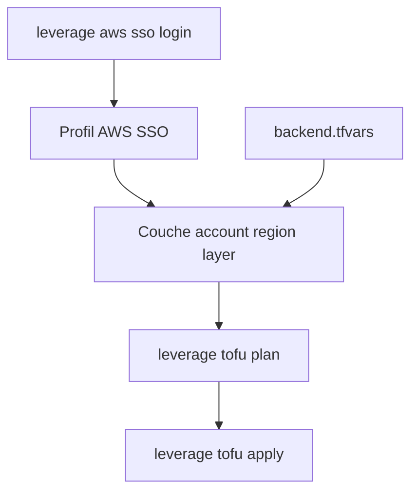

# binbashar/le-tf-infra-aws

> Architecture de référence OpenTofu pour AWS de Binbash Leverage, pilotée par la CLI Leverage.

## Le problème
Monter un ensemble de comptes AWS cohérents (identités, réseau, couches) sans conventions écrites mène au désordre.

## Ce que ça fait vraiment
Dépôt de configuration OpenTofu organisé en couches par compte et par région, piloté par la CLI `leverage` (v2.2.0+, OpenTofu natif, sans Docker). Authentification par AWS SSO, variables dans `config/*.tfvars`. Il embarque aussi des réglages Claude Code, des agents, des serveurs MCP et un flux de revue assisté par IA.

## Comment c'est branché


## Essayer
```bash
pip install leverage
leverage aws sso login
leverage tofu init
leverage tofu plan
leverage tofu apply
```

## Coût et pièges
Il faut AWS SSO configuré, le binaire `tofu` local et Python 3.12 pour l'environnement conseillé. Les ressources AWS sont facturées. Le serveur MCP AWS est lancé en lecture seule.

## Ce que ce n'est pas
Pas un module réutilisable : une architecture de référence spécifique à Binbash. La part IA (Claude Code, Codex, Bedrock) est un cadre de développement, pas une fonction du produit.

## Alternatives
Aucune alternative nommée dans le README.

## Pour toi
À surveiller si tu veux voir comment structurer une infra AWS multi-comptes en OpenTofu avec des agents IA ; à copier en idées plus qu'à déployer.

