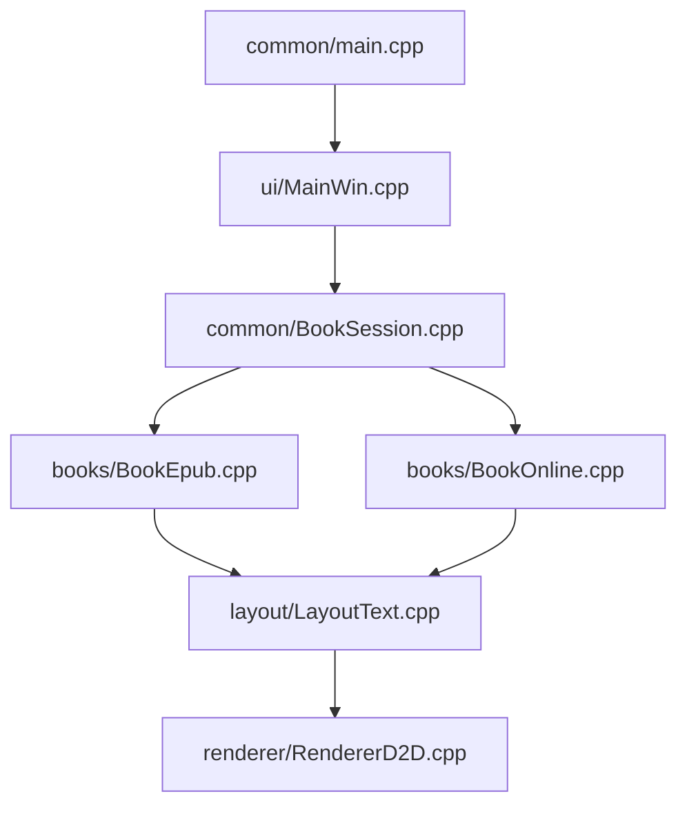

# binbyu/Reader

> Lightweight native Windows e-book reader in C++/Win32, to read TXT, EPUB, MOBI and online novels.

## The problem
Read local or online novels in a discreet window, without heavy software, on Windows.

## What it actually does
Reader opens TXT files (encoding detection), EPUB and MOBI, and reads online novels through book sources with XPath rules. It also connects to a Legado web service on the local network. Direct2D rendering with GDI+ fallback, borderless and transparent window, quick-hide shortcuts.

## How it is wired


## Trying it
```bash
# Aucune commande : télécharger le paquet x64 ou x86 dans GitHub Releases
```

## Cost and gotchas
Free, Windows only. License not declared, and the README forbids any commercial use. Some antivirus programs may flag the binary (false positive announced by the author). Interface and docs in Chinese.

## What it is not
Not a productivity or monitoring tool: it is a novel reader. It provides no content; texts come from third-party sources.

## Alternatives
No alternative cited (only the Legado service, which is compatible).

## For you
Ignore: off-topic for data, AI and MLOps, and no license.
