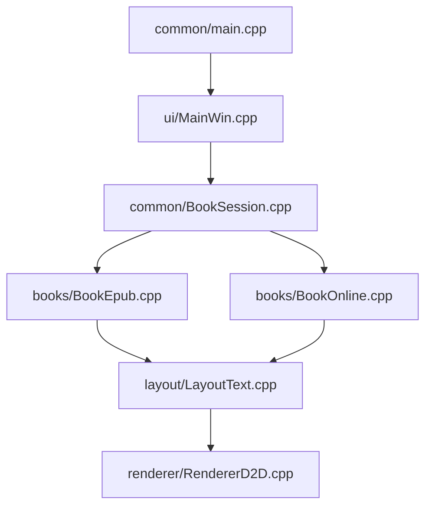

# binbyu/Reader

> Lecteur de livres numériques Windows natif en C++/Win32, léger, pour lire TXT, EPUB, MOBI et romans en ligne.

## Le problème
Lire des romans locaux ou en ligne dans une fenêtre discrète, sans logiciel lourd, sous Windows.

## Ce que ça fait vraiment
Reader ouvre les fichiers TXT (détection d'encodage), EPUB et MOBI, et lit des romans en ligne via des sources de livres à règles XPath. Il se connecte aussi à un service web Legado du réseau local. Rendu Direct2D avec repli GDI+, fenêtre sans bordure et transparente, raccourcis de masquage rapide.

## Comment c'est branché


## Essayer
```bash
# Aucune commande : télécharger le paquet x64 ou x86 dans GitHub Releases
```

## Coût et pièges
Gratuit, Windows seulement. Licence non déclarée, et le README interdit tout usage commercial. Des antivirus peuvent signaler le binaire (faux positif annoncé par l'auteur). Interface et doc en chinois.

## Ce que ce n'est pas
Pas un outil de productivité ni de veille : c'est un lecteur de romans. Il ne fournit aucun contenu, les textes viennent de sources tierces.

## Alternatives
Aucune alternative citée (seulement le service Legado, compatible).

## Pour toi
À ignorer : hors sujet data, IA et MLOps, et licence absente.

