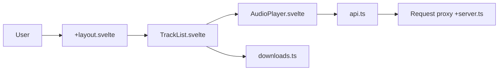

# binimum/tidal-ui

> SvelteKit interface for high-fidelity music streaming, now archived by its author.

## The problem
Getting a lightweight web interface to listen to and download music without going through the official client.

## What it actually does
SvelteKit/Tailwind frontend that queries a "HIFI" API: search, link import, playback, FLAC downloads up to 24 bits/192 kHz, lyrics, album, artist and playlist views. A SvelteKit `/api/proxy` proxy avoids CORS errors. Redis is deprecated.

## How it is wired


## Trying it
```bash
docker compose up --build
```
Copy `.env.example` to `.env` first.

## Cost and gotchas
The README says it is reserved for holders of an active Tidal account and reminds that piracy is illegal. The demo site redirects elsewhere.

## What it is not
Not maintained: repository archived, author moved on to other projects. "It works (kinda)" is the only feature promise.

## Alternatives
- Monochrome, cited by the author as the successor.

## For you
Ignore: archived, legally dubious area and unrelated to data/AI.
