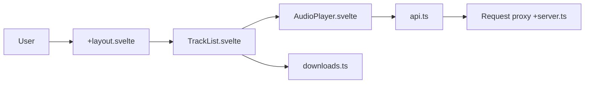

# binimum/tidal-ui

> Interface SvelteKit de streaming musical haute fidélité, aujourd'hui archivée par son auteur.

## Le problème
Obtenir une interface web légère pour écouter et télécharger de la musique sans passer par le client officiel.

## Ce que ça fait vraiment
Frontend SvelteKit/Tailwind qui interroge une API « HIFI » : recherche, import de liens, lecture, téléchargements FLAC jusqu'à 24 bits/192 kHz, paroles, vues album, artiste, playlist. Un proxy SvelteKit `/api/proxy` évite les erreurs CORS. Redis est déprécié.

## Comment c'est branché


## Essayer
```bash
docker compose up --build
```
Copier d'abord `.env.example` en `.env`.

## Coût et pièges
Le README dit réservé aux détenteurs d'un compte Tidal actif et rappelle que le piratage est illégal. Le site de démonstration redirige ailleurs.

## Ce que ce n'est pas
Pas maintenu : dépôt archivé, auteur passé à d'autres projets. « It works (kinda) » est la seule promesse de fonctionnalité.

## Alternatives
- Monochrome, cité par l'auteur comme successeur.

## Pour toi
Ignorer : archivé, zone juridique douteuse et sans rapport avec data/IA.

