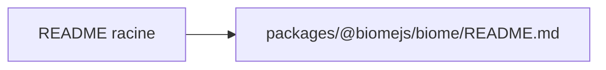

# biomejs/biome

> README tronqué : seul un chemin de fichier est présent, la fonction du dépôt n'est pas décrite.

## Le problème
Non documenté dans le README lu.

## Ce que ça fait vraiment
Fiche minimale. Le README se réduit à la ligne `./packages/@biomejs/biome/README.md`, un renvoi vers un autre fichier non fourni. Aucun fait fonctionnel ne peut en être tiré ; la nature (outil), le déploiement (npm) et les prérequis sont déduits du seul nom de chemin `packages/@biomejs/biome` et restent à vérifier.

## Comment c'est branché
Non documenté.

## Essayer
Aucune commande documentée.

## Coût et pièges
Non documenté. Licence Apache-2.0, 514 issues ouvertes, dernier push le 2026-10-23.

## Ce que ce n'est pas
Rien ne peut être exclu à partir du README : lire le README du sous-paquet avant toute conclusion.

## Alternatives
Aucune nommée dans le README.

## Pour toi
À surveiller sans trancher : le dépôt est très actif (étoiles, push récent), mais la fiche ne peut pas dire à quoi il sert ; relire avec le vrai README.

