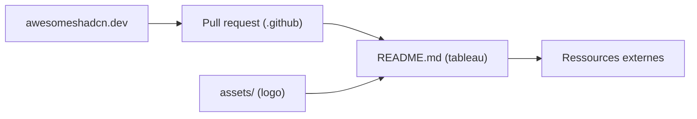

# birobirobiro/awesome-shadcn-ui

> Curated list of libraries and components around shadcn/ui, for React developers.

Note: the README was only partly read (a section of the table could not be loaded); this sheet relies on the beginning and the end of the file.

## The problem
The shadcn/ui ecosystem has a very large number of scattered third-party building blocks: a dated catalog is needed to find your way around.

## What it actually does
An alphabetical table (name, description, link, date) of libraries and components: animations, calendars, date pickers, data tables, drag and drop, AI chat, registries installable via the shadcn CLI. Among the entries read: `assistant-ui` (AI chat components), `localmode` (local AI components in the browser), `agents-ui` (voice agent interfaces). The repository also includes a website with a submission form.

## How it is wired

## Trying it
No command documented in the part read. The README says to read CONTRIBUTING.md before proposing an entry, by form or by PR.

## Cost and gotchas
Free. Each entry has its own license and its own level of maturity; some offer paid plans (explicitly mentioned in two descriptions read).

## What it is not
It is not an installable library, but an index. It guarantees neither the quality nor the longevity of the links.

## Alternatives
No alternative cited in the part of the README that was read.

## For you
Watch: useful to consult when you build an interface for an AI tool in React, of no interest outside that need.
