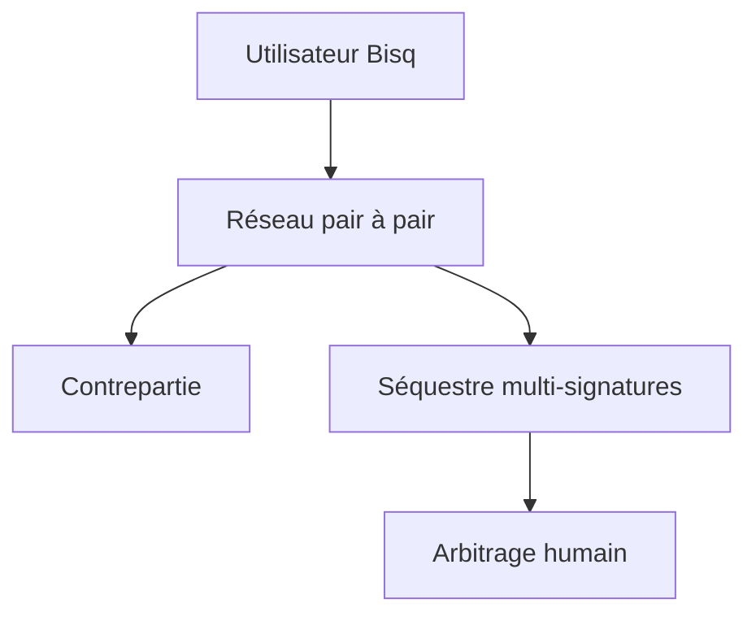

# bisq-network/bisq

> Peer-to-peer application for exchanging bitcoin for currencies, with no intermediary and no custody of funds.

## The problem
Exchanging bitcoin for national currencies usually goes through a centralized platform that holds the funds.

## What it actually does
Bisq connects peers on a decentralized network, with multi-signature escrow, without a third party. It does not hold funds and provides for human arbitration in disputes. The README is very short: detailed installation and operation are on the project's website.

## How it is wired
Simplified diagram based on the sheet, no diagram provided.



## Trying it
```bash
# Aucune commande dans le README : suivre bisq.network/get-started
```

## Cost and gotchas
Free on the software side (AGPL-3.0, copyleft); any transaction fees are not documented here. You have to manage your own funds and risks.

## What it is not
Not a bank or a custody service: in case of error, nobody reimburses you. The README's content is insufficient to judge further.

## Alternatives
No alternative cited in the README.

## For you
Ignore: decentralized finance, unrelated to a data, AI or MLOps pipeline.
