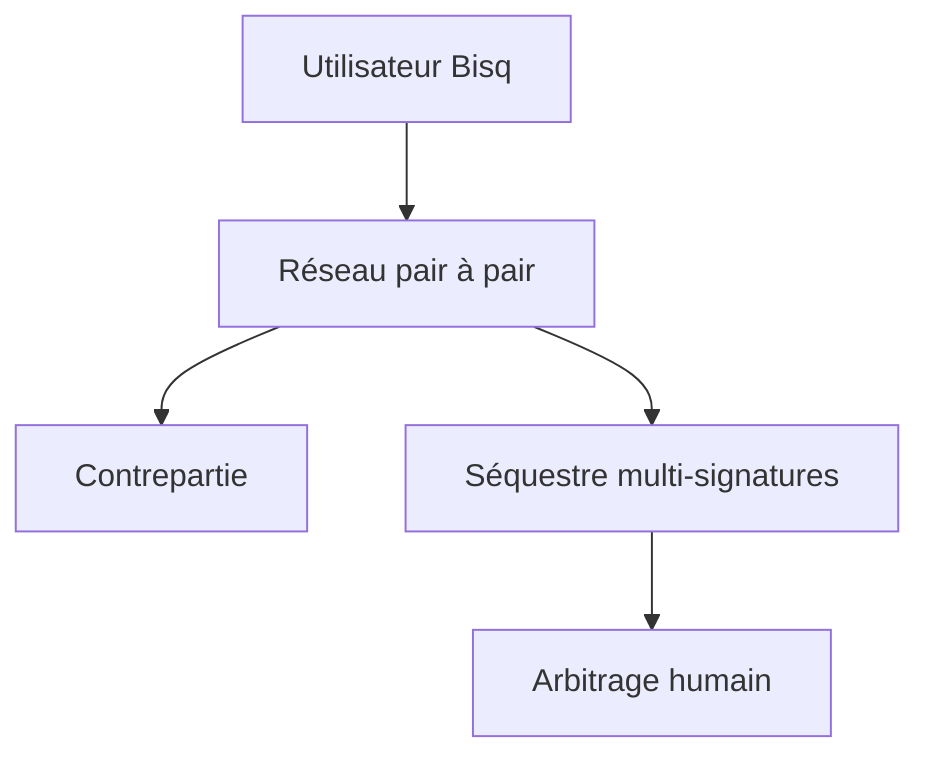

# bisq-network/bisq

> Application pair à pair d'échange de bitcoin contre des monnaies, sans intermédiaire ni garde des fonds.

## Le problème
Échanger du bitcoin contre des monnaies nationales passe d'habitude par une plateforme centralisée qui garde les fonds.

## Ce que ça fait vraiment
Bisq met en relation des pairs sur un réseau décentralisé, avec séquestre multi-signatures, sans tiers. Il ne garde pas les fonds et prévoit un arbitrage humain pour les litiges. Le README est très court : installation et fonctionnement détaillés sont sur le site du projet.

## Comment c'est branché
Schéma simplifié d'après la fiche, sans diagramme fourni.



## Essayer
```bash
# Aucune commande dans le README : suivre bisq.network/get-started
```

## Coût et pièges
Gratuit côté logiciel (AGPL-3.0, copyleft) ; frais éventuels de transaction non documentés ici. Il faut gérer ses propres fonds et risques.

## Ce que ce n'est pas
Pas une banque ni un service de garde : en cas d'erreur, personne ne rembourse. Matière du README insuffisante pour juger plus loin.

## Alternatives
Aucune alternative citée dans le README.

## Pour toi
À ignorer : finance décentralisée, sans lien avec un pipeline data, IA ou MLOps.

