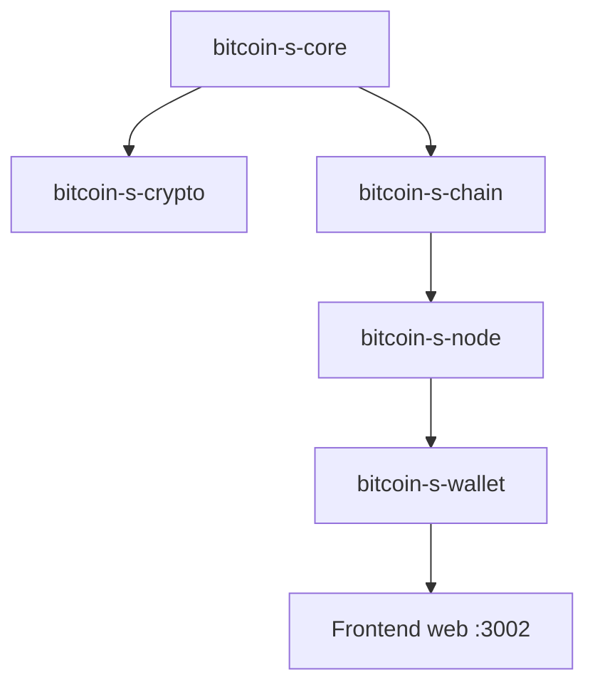

# bitcoin-s/bitcoin-s

> Scala toolkit for building Bitcoin and Lightning applications on the JVM.

## The problem
Building a Bitcoin wallet or node on the JVM forces you to reimplement cryptography, protocol and RPC access.

## What it actually does
The project publishes sbt modules (core, crypto, chain, node, wallet, dlc-oracle, bitcoind, eclair and lnd clients, cli). It also offers a Docker stack that syncs the backend and serves a web wallet interface on port 3002. Images are published on Docker Hub on every merge.

## How it is wired
Simplified diagram based on the fiche, no diagram provided.


## Trying it
```bash
APP_PASSWORD=topsecret docker compose up
git clone https://github.com/bitcoin-s/bitcoin-s-ts.git
cd bitcoin-s-ts && ./build-wallet-electron.sh
```

## Cost and gotchas
Free. Docker for the stack, Scala/sbt for the library. Chain synchronization takes disk space and time. The password in the example is just an example to change.

## What it is not
Not a ready-to-use consumer wallet. The full documentation is on an external site, not in the README.

## Alternatives
No alternative named in the README.

## For you
Ignore: Bitcoin domain on the JVM, foreign to data or MLOps work.
