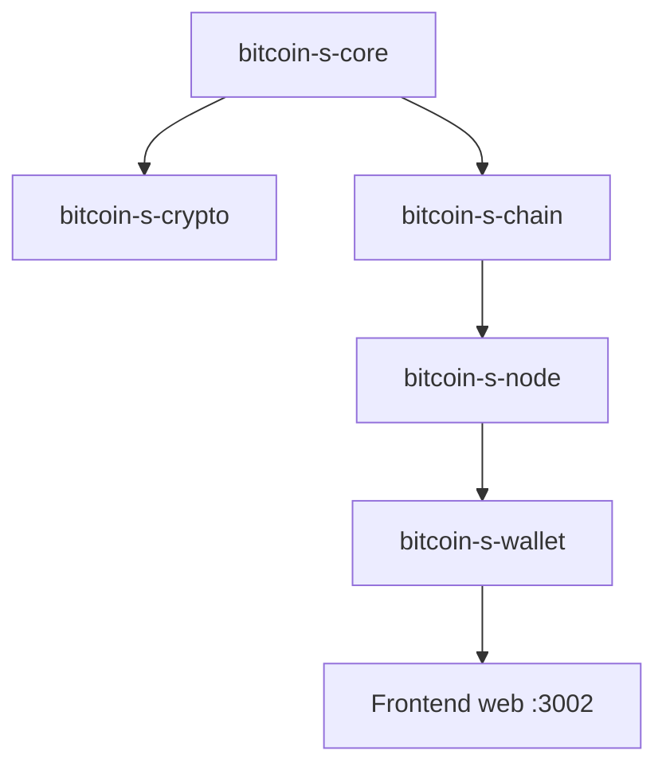

# bitcoin-s/bitcoin-s

> Boîte à outils Scala pour construire des applications Bitcoin et Lightning sur la JVM.

## Le problème
Construire un portefeuille ou un nœud Bitcoin sur la JVM oblige à réimplémenter cryptographie, protocole et accès RPC.

## Ce que ça fait vraiment
Le projet publie des modules sbt (core, crypto, chain, node, wallet, dlc-oracle, clients bitcoind, eclair et lnd, cli). Il offre aussi une pile Docker qui synchronise le backend et sert une interface web de portefeuille sur le port 3002. Des images sont publiées sur Docker Hub à chaque fusion.

## Comment c'est branché
Schéma simplifié d'après la fiche, sans diagramme fourni.


## Essayer
```bash
APP_PASSWORD=topsecret docker compose up
git clone https://github.com/bitcoin-s/bitcoin-s-ts.git
cd bitcoin-s-ts && ./build-wallet-electron.sh
```

## Coût et pièges
Gratuit. Docker pour la pile, Scala/sbt pour la bibliothèque. La synchronisation de la chaîne prend du disque et du temps. Le mot de passe de l'exemple est un simple exemple à changer.

## Ce que ce n'est pas
Ce n'est pas un portefeuille grand public prêt à l'emploi. La documentation complète est sur un site externe, pas dans le README.

## Alternatives
Aucune alternative nommée dans le README.

## Pour toi
À ignorer : domaine Bitcoin sur la JVM, étranger à un travail data ou MLOps.

