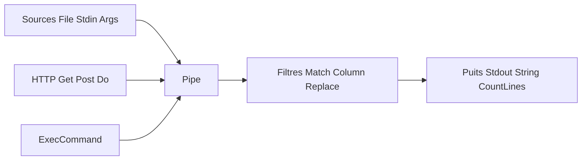

# bitfield/script

> Go library that reproduces shell script pipelines (reading, filters, subprocesses) in typed Go.

## The problem
Shell administration scripts are fragile; in Go, reading a file, filtering lines and running commands takes a lot of code.

## What it is not but: a `Source → Filters → Sinks` chaining API, run concurrently, that remembers the error of the first failing stage.

## What it actually does
Sources (`File`, `Stdin`, `Args`, `Get`, `ExecCommand`), filters (`Match`, `Column`, `Replace`, `JQ`, `Freq`, `ExecForEach`, custom `Filter`) and sinks (`String`, `Stdout`, `CountLines`, `WriteFile`). The README gives a table of Unix equivalents and a one-line example counting visitors in an Apache log.

## How it is wired


## Trying it
```go
import "github.com/bitfield/script"

numErrors, err := script.File("test.txt").Match("Error").CountLines()
script.Stdin().Column(1).Freq().First(10).Stdout()
```

## Cost and gotchas
Free. Filters run concurrently: call `Wait` to wait for completion. HTTP responses outside 200–299 are treated as errors.

## What it is not
Not a shell interpreter: no piping between arbitrary processes outside its API. An external `go-script` interpreter is mentioned.

## Alternatives
`go-script` (Simon Willison's bash interpreter) to run one-liners without compiling.

## For you
Worth watching: useful only if you already write tools in Go; otherwise your shell or Python is enough.
