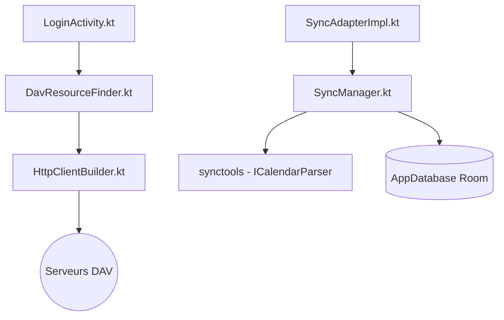

# bitfireAT/davx5-ose

> Android app that syncs contacts, calendars and tasks with a CalDAV/CardDAV server, and mounts WebDAV folders.

## The problem
Android natively syncs contacts and calendars only with proprietary services; anyone hosting their own server has no built-in client.

## What it actually does
The Kotlin app discovers the server's DAV accounts and collections, then syncs calendars, contacts, tasks and JTX notes with the Android stores via SyncAdapter and WorkManager. A `synctools` library translates iCalendar and vCard. Connections go through URL or email, or OAuth (Nextcloud, Google, Fastmail). A document provider also exposes WebDAV in the Android file picker.

## How it is wired

## Trying it
No command documented in the README: see the DAVx⁵ website for the manual and the list of tested services.

## Cost and gotchas
Price and distribution channel not documented in the README. A DAV server is required (self-hosted or third-party). GPLv3 license: copyleft. 71 open issues.

## What it is not
It is neither a server nor an iOS app: only the Android client. It is not a development tool: you touch it as an end user.

## Alternatives
No alternative named in the README.

## For you
Ignore for your line of work: an Android app for syncing contacts and calendars, unrelated to data, AI or MLOps, well maintained and useful only for personal use.
