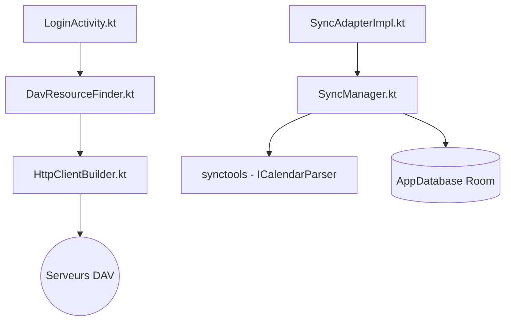

# bitfireAT/davx5-ose

> Application Android qui synchronise contacts, agendas et tâches avec un serveur CalDAV/CardDAV, et monte des dossiers WebDAV.

## Le problème
Android ne synchronise nativement contacts et agendas qu'avec des services propriétaires ; qui héberge son propre serveur n'a pas de client intégré.

## Ce que ça fait vraiment
L'app Kotlin découvre les comptes et collections DAV du serveur, puis synchronise calendriers, contacts, tâches et notes JTX avec les stores Android via SyncAdapter et WorkManager. Une bibliothèque `synctools` traduit iCalendar et vCard. Les connexions passent par URL ou email, ou OAuth (Nextcloud, Google, Fastmail). Un fournisseur de documents expose aussi WebDAV dans le sélecteur de fichiers Android.

## Comment c'est branché

## Essayer
Aucune commande documentée dans le README : voir le site de DAVx⁵ pour le manuel et la liste des services testés.

## Coût et pièges
Prix et canal de distribution non documentés dans le README. Il faut un serveur DAV (auto-hébergé ou tiers). Licence GPLv3 : copyleft. 71 issues ouvertes.

## Ce que ce n'est pas
Ce n'est ni un serveur ni une app iOS : uniquement le client Android. Ce n'est pas un outil de développement : on y touche en tant qu'utilisateur final.

## Alternatives
Aucune alternative nommée dans le README.

## Pour toi
À ignorer pour ton métier : une app Android de synchronisation de contacts et d'agendas, sans rapport avec data, IA ou MLOps, bien maintenue et utile seulement à titre personnel.

