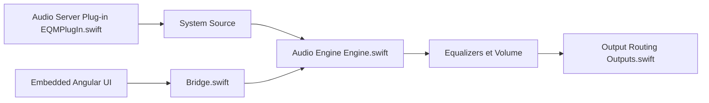

# bitgapp/eqMac

> System-wide audio equalizer for macOS, whose open source code only matches version 1.3.2 without Pro features.

## The problem
macOS has no equalizer or volume gain at the system level.

## What it actually does
A user-space CoreAudio driver captures system audio, the Swift application applies volume, boost, balance and equalizers (basic, 10-band), then routes to the chosen output. The Angular interface is embedded and designed for remote updates. The README additionally advertises Pro features (unlimited equalizer, spectrum analyzer, per-application mixer) absent from this repository.

## How it is wired

## Trying it
No command documented in the README.

## Cost and gotchas
The repository is frozen at v1.3.2; recent versions are on a private fork, with paid Pro features.

## What it is not
Not the current version of the application nor all of its features.

## Alternatives
No alternative named in the README.

## For you
Ignore: a macOS audio utility whose open source code is an old version, unrelated to data/AI/MLOps.
