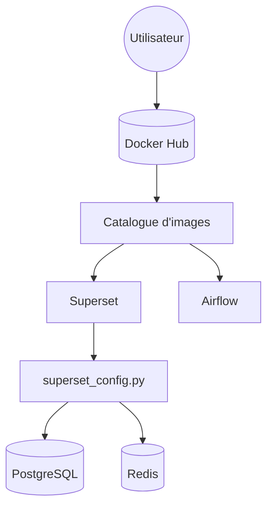

# bitnami/containers

> Catalog of Docker images for popular applications, for those who want to run them without building them.

## The problem
Installing Airflow, Superset or PostgreSQL with their dependencies and configuration is time-consuming and differs from one machine to another.

## What it actually does
Provides the Dockerfiles and a `docker-compose.yml` per application, with images published on Docker Hub. The README highlights hardened images (Photon Linux, security metadata, SBOM), some of whose data is only accessible with a commercial subscription. Images are scanned with Trivy and Grype.

## How it is wired


## Trying it
```console
docker pull bitnami/APP
docker pull bitnami/APP:[TAG]
git clone https://github.com/bitnami/containers.git
cd bitnami/APP/VERSION/OPERATING-SYSTEM
docker build -t bitnami/APP .
curl -sSL https://raw.githubusercontent.com/bitnami/containers/main/bitnami/APP/docker-compose.yml > docker-compose.yml
docker-compose up -d
```

## Cost and gotchas
Docker required. The old generation of Debian-based images is in a "Legacy" registry, and deprecated images are archived after at least six months. Part of the security data is reserved for subscribers.

## What it is not
It is not a single piece of software but a catalog: each image has its own lifecycle. The security features described are not all free.

## Alternatives
No alternative named in the README.

## For you
Watch: handy for quickly standing up an MLOps stack (Airflow, Superset), but the commercial part and the archiving of old images mean you should check the tag you use.
