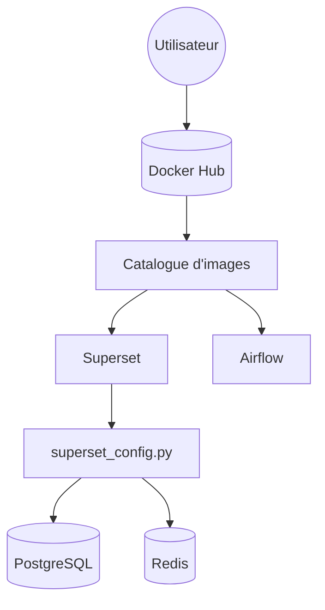

# bitnami/containers

> Catalogue d'images Docker d'applications populaires, pour qui veut les lancer sans les construire.

## Le problème
Installer Airflow, Superset ou PostgreSQL avec leurs dépendances et leur configuration est long et diffère d'une machine à l'autre.

## Ce que ça fait vraiment
Fournit les Dockerfile et un `docker-compose.yml` par application, avec des images publiées sur Docker Hub. Le README met en avant des images durcies (Photon Linux, métadonnées de sécurité, SBOM), dont certaines données ne sont accessibles que sur abonnement commercial. Les images sont analysées par Trivy et Grype.

## Comment c'est branché


## Essayer
```console
docker pull bitnami/APP
docker pull bitnami/APP:[TAG]
git clone https://github.com/bitnami/containers.git
cd bitnami/APP/VERSION/OPERATING-SYSTEM
docker build -t bitnami/APP .
curl -sSL https://raw.githubusercontent.com/bitnami/containers/main/bitnami/APP/docker-compose.yml > docker-compose.yml
docker-compose up -d
```

## Coût et pièges
Docker requis. L'ancienne génération d'images basée sur Debian est dans un registre « Legacy » et les images dépréciées sont archivées après au moins six mois. Une part des données de sécurité est réservée aux abonnés.

## Ce que ce n'est pas
Ce n'est pas un seul logiciel mais un catalogue : chaque image a son propre cycle de vie. Les fonctions de sécurité décrites ne sont pas toutes gratuites.

## Alternatives
Aucune alternative nommée dans le README.

## Pour toi
Surveiller : pratique pour monter vite une pile MLOps (Airflow, Superset), mais la part commerciale et l'archivage des anciennes images demandent de vérifier le tag utilisé.

