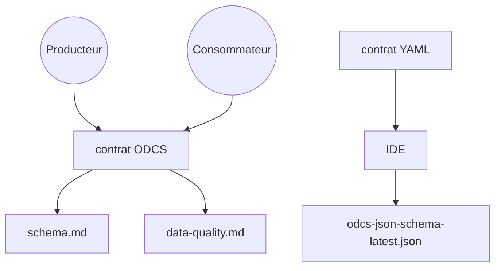

# bitol-io/open-data-contract-standard

> Open standard, in YAML and JSON Schema, for describing a data contract between producer and consumer.

## The problem
Data producers and consumers agree verbally on schema, quality and service commitments, with no shared format.

## What it actually does
Defines the structure of a data contract, in version 3.2.0: fundamentals, schema, references, quality, support, pricing, team, roles, service level agreement, servers, reference definitions, tags and custom properties. A JSON Schema validates the YAML files in the IDE (IntelliJ, VS Code). Official media type: application/odcs+yaml.

## How it is wired


## Trying it
```bash
# Aucune commande dans le README : importer le JSON Schema dans l'IDE
# pour valider un contrat YAML.
```

## Cost and gotchas
Free. It is a specification: third-party tools are needed to enforce it or check it at runtime.

## What it is not
Not a service or a quality-control tool: the standard describes, it executes nothing.

## Alternatives
No alternative named in the README.

## For you
Adopt it to formalise data contracts between teams: an open standard under Apache 2.0, directly useful in MLOps and data governance.
