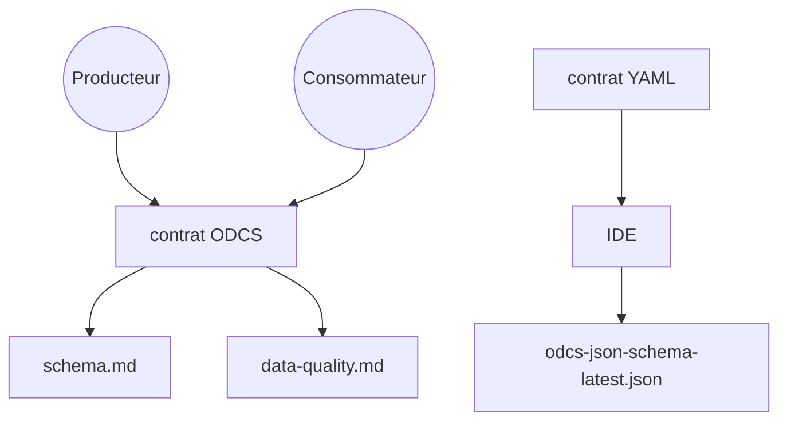

# bitol-io/open-data-contract-standard

> Standard ouvert, en YAML et JSON Schema, pour décrire un contrat de données entre producteur et consommateur.

## Le problème
Producteurs et consommateurs de données s'accordent oralement sur schéma, qualité et engagements de service, sans format partagé.

## Ce que ça fait vraiment
Définit la structure d'un contrat de données, en version 3.2.0 : fondamentaux, schéma, références, qualité, support, prix, équipe, rôles, accord de niveau de service, serveurs, définitions de référence, étiquettes et propriétés libres. Un JSON Schema valide les fichiers YAML dans l'IDE (IntelliJ, VS Code). Type média officiel : application/odcs+yaml.

## Comment c'est branché


## Essayer
```bash
# Aucune commande dans le README : importer le JSON Schema dans l'IDE
# pour valider un contrat YAML.
```

## Coût et pièges
Gratuit. C'est une spécification : il faut des outils tiers pour la faire appliquer ou la contrôler à l'exécution.

## Ce que ce n'est pas
Pas un service ni un outil de contrôle qualité : le standard décrit, il n'exécute rien.

## Alternatives
Aucune alternative nommée dans le README.

## Pour toi
À adopter pour formaliser des contrats de données entre équipes : standard ouvert en Apache 2.0, directement utile en MLOps et gouvernance des données.

