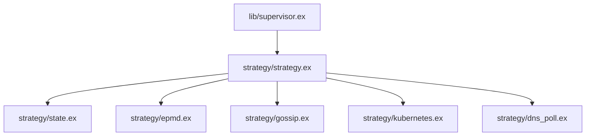

# bitwalker/libcluster

> Automatic formation and healing of Erlang/Elixir node clusters, with pluggable strategies.

## The problem
Erlang nodes in a dynamic deployment (containers, Kubernetes) must discover each other and reconnect without manual configuration.

## What it actually does
A `Cluster.Supervisor` starts one strategy per topology: Epmd, LocalEpmd, ErlangHosts, Gossip (UDP multicast), Kubernetes (API or DNS), Rancher. You can write your own strategy or replace the Erlang distribution. The README details node naming, startup and rolling deployments under Kubernetes.

## How it is wired


## Trying it
```bash
mix hex.info libcluster
```
```elixir
{:libcluster, "~> MAJ.MIN"}
```

## Cost and gotchas
Free. It connects nodes but does not distribute code; on Kubernetes, long names, a shared cookie and EPMD ports to allow, and a DNS failure can disconnect peers.

## What it is not
Not an orchestrator or a deployment tool. A discovery selector does not isolate groups of nodes.

## Alternatives
Partisan: alternative distribution layer that libcluster can host. Firenest: cited distribution project.

## For you
Ignore: serves Elixir clusters, outside your data/AI/MLOps stack.
