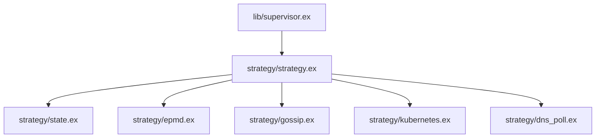

# bitwalker/libcluster

> Formation et réparation automatiques de clusters de nœuds Erlang/Elixir, avec stratégies enfichables.

## Le problème
Les nœuds Erlang d'un déploiement dynamique (conteneurs, Kubernetes) doivent se découvrir et se reconnecter sans configuration manuelle.

## Ce que ça fait vraiment
Un `Cluster.Supervisor` démarre une stratégie par topologie : Epmd, LocalEpmd, ErlangHosts, Gossip (UDP multicast), Kubernetes (API ou DNS), Rancher. Possibilité d'écrire sa stratégie ou de remplacer la distribution Erlang. Le README détaille nommage des nœuds, démarrage et déploiements progressifs sous Kubernetes.

## Comment c'est branché


## Essayer
```bash
mix hex.info libcluster
```
```elixir
{:libcluster, "~> MAJ.MIN"}
```

## Coût et pièges
Gratuit. Il connecte des nœuds mais ne distribue pas le code ; en Kubernetes, noms longs, cookie partagé et ports EPMD à autoriser, et un échec DNS peut déconnecter des pairs.

## Ce que ce n'est pas
Pas un orchestrateur ni un outil de déploiement. Un sélecteur de découverte n'isole pas les groupes de nœuds.

## Alternatives
Partisan : couche de distribution alternative que libcluster peut accueillir. Firenest : projet de distribution cité.

## Pour toi
À ignorer : sert aux clusters Elixir, hors de ta pile data/IA/MLOps.

