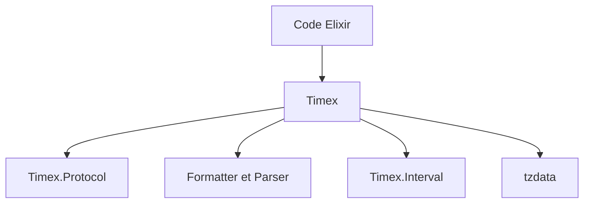

# bitwalker/timex

> Elixir library for handling dates, times and time zones, aimed at Elixir developers.

## The problem
Date calculations, formats and time zone conversions are error-prone, and Elixir's standard library covers only part of them.

## What it actually does
It provides creation, shifting, comparison, formatting and parsing of dates and durations, with time zones via `:tzdata` and POSIX-TZ support. It adds intervals and extensible protocols for custom date types. Version 4 requires Elixir 1.16 and OTP 26, and drops Hackney.

## How it is wired
Simplified diagram based on the card, no diagram provided.



## Trying it
```elixir
use Timex
Timex.today()
Timex.now("America/Chicago")
Timex.shift(Timex.now(), hours: 2, minutes: 13)
```

## Cost and gotchas
Free. Time zone updates use tzdata's HTTP client and assume an accessible set of CA certificates. The move to version 4 comes with behavior changes worth reading.

## What it is not
It is not essential: the README advises evaluating the standard `Calendar` API first. It cannot be used outside Elixir.

## Alternatives
- Elixir standard library `Calendar` API: enough for many cases, no dependency.

## For you
Ignore for a data / AI / MLOps profile, unless your code is in Elixir: it only concerns that ecosystem.
