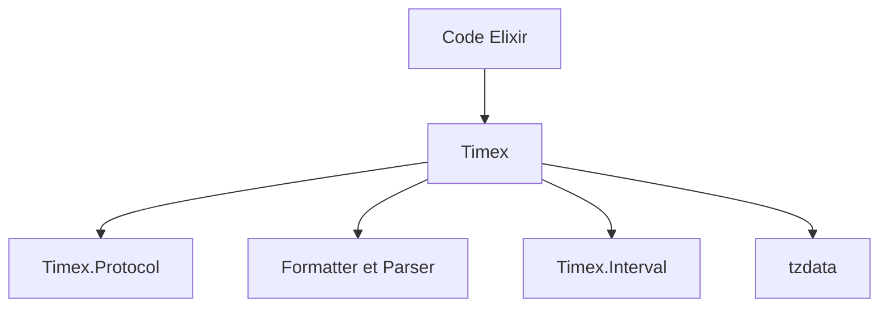

# bitwalker/timex

> Bibliothèque Elixir pour manipuler dates, heures et fuseaux horaires, destinée aux développeurs Elixir.

## Le problème
Calculs de dates, formats et conversions de fuseaux horaires sont sources d'erreurs, et la bibliothèque standard d'Elixir en couvre une partie seulement.

## Ce que ça fait vraiment
Elle fournit création, décalage, comparaison, formatage et analyse de dates et de durées, avec les fuseaux via `:tzdata` et le support POSIX-TZ. Elle ajoute des intervalles et des protocoles extensibles pour des types de dates personnalisés. La version 4 exige Elixir 1.16 et OTP 26, et abandonne Hackney.

## Comment c'est branché
Schéma simplifié d'après la fiche, sans diagramme fourni.



## Essayer
```elixir
use Timex
Timex.today()
Timex.now("America/Chicago")
Timex.shift(Timex.now(), hours: 2, minutes: 13)
```

## Coût et pièges
Gratuit. La mise à jour des fuseaux utilise le client HTTP de tzdata et suppose un jeu de certificats CA accessible. Le passage à la version 4 comporte des changements de comportement à lire.

## Ce que ce n'est pas
Ce n'est pas indispensable : le README conseille d'évaluer d'abord l'API `Calendar` standard. Ce n'est pas utilisable hors d'Elixir.

## Alternatives
- API `Calendar` de la bibliothèque standard Elixir : suffisante pour beaucoup de cas, sans dépendance.

## Pour toi
À ignorer pour un profil data / IA / MLOps, sauf si ton code est en Elixir : il ne concerne que cet écosystème.

