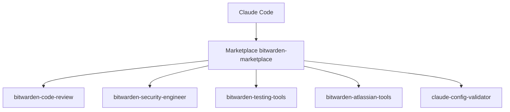

# bitwarden/ai-plugins

> Catalogue of Claude Code plugins used at Bitwarden for AI-assisted development.

## The problem
Distributing quality-controlled plugins to teams that use Claude Code requires a common access point.

## What it actually does
A marketplace of 23 plugins: code review, technical planning, Jira and Atlassian tools, testing and Testmo, security, DevOps, design, AI usage telemetry, retrospective, configuration validation. It is added with a Claude Code command.

## How it is wired
Simplified diagram based on the sheet, no diagram provided.



## Trying it
```bash
/plugin marketplace add bitwarden/ai-plugins
/plugin install plugin-name@bitwarden-marketplace
/plugin marketplace update bitwarden-marketplace
```

## Cost and gotchas
Free, but you need Claude Code and, depending on the plugin, Jira, Atlassian, Stripe or Testmo accounts. The `bitwarden-ai-telemetry` plugin emits usage data tagged with the email address.

## What it is not
Not a generic toolbox: many plugins reflect Bitwarden's internal processes. The license is not identified by GitHub.

## Alternatives
No alternative named in the README.

## For you
Worth watching: a good example of team plugins to read for inspiration, but only install them after checking what each one sends.
