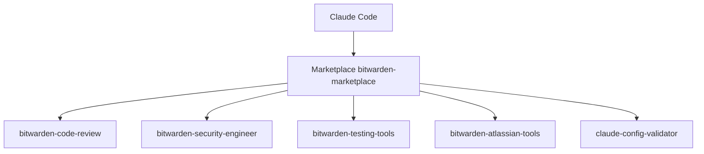

# bitwarden/ai-plugins

> Catalogue de plugins Claude Code utilisés chez Bitwarden pour le développement assisté par IA.

## Le problème
Distribuer des plugins de qualité contrôlée à des équipes qui utilisent Claude Code demande un point d'accès commun.

## Ce que ça fait vraiment
Une place de marché de 23 plugins : revue de code, planification technique, outils Jira et Atlassian, tests et Testmo, sécurité, DevOps, conception, télémétrie d'usage IA, rétrospective, validation de configuration. Elle s'ajoute avec une commande Claude Code.

## Comment c'est branché
Schéma simplifié d'après la fiche, sans diagramme fourni.



## Essayer
```bash
/plugin marketplace add bitwarden/ai-plugins
/plugin install plugin-name@bitwarden-marketplace
/plugin marketplace update bitwarden-marketplace
```

## Coût et pièges
Gratuit, mais il faut Claude Code et, selon le plugin, des comptes Jira, Atlassian, Stripe ou Testmo. Le plugin `bitwarden-ai-telemetry` émet des données d'usage taguées par l'adresse e-mail.

## Ce que ce n'est pas
Pas une boîte à outils générique : beaucoup de plugins reflètent les processus internes de Bitwarden. La licence n'est pas identifiée par GitHub.

## Alternatives
Aucune alternative nommée dans le README.

## Pour toi
À surveiller : bon exemple de plugins d'équipe à lire pour t'inspirer, mais à n'installer qu'après avoir regardé ce que chacun envoie.

