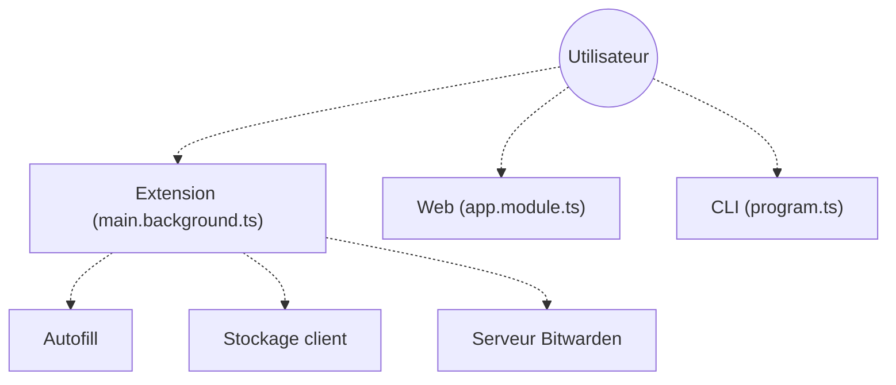

# bitwarden/clients

> Code for the non-mobile Bitwarden clients: browser extension, web app, desktop and command line.

## The problem
Managing your passwords safely and in sync across browser, workstation and terminal.

## What it actually does
Source repository of the password manager's clients: extension (authentication, autofill, passkeys), web app, desktop (Electron) and CLI. It also contains vault search, import, billing and organization risk reports. All of them connect to the Bitwarden server. The README points to the documentation for building.

## How it is wired

## Trying it
No command documented in the README: the build instructions are in the external contribution documentation.

## Cost and gotchas
The repository is free to read; the Bitwarden service has paid plans (billing is in the code). A Bitwarden server is required. License present but not identified by GitHub: to be checked (a `bitwarden_license` folder exists).

## What it is not
Not the server nor the mobile apps: they are in other repositories. Not a product you launch with a single command from this README.

## Alternatives
- bitwarden/server: the backend, to pair with these clients.

## For you
Worth watching: useful to read if you want to understand a serious browser extension, but for everyday use you install the published product.
