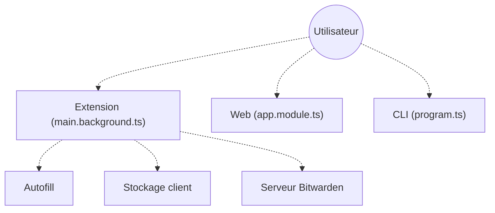

# bitwarden/clients

> Code des clients Bitwarden hors mobile : extension de navigateur, application web, bureau et ligne de commande.

## Le problème
Gérer ses mots de passe de façon sûre et synchronisée entre navigateur, poste de travail et terminal.

## Ce que ça fait vraiment
Dépôt source des clients du gestionnaire de mots de passe : extension (authentification, remplissage automatique, passkeys), application web, bureau (Electron) et CLI. On y trouve aussi la recherche dans le coffre, l'import, la facturation et des rapports de risque d'organisation. Tous se connectent au serveur Bitwarden. Le README renvoie à la documentation pour construire.

## Comment c'est branché

## Essayer
Aucune commande documentée dans le README : les instructions de construction sont dans la documentation de contribution externe.

## Coût et pièges
Le dépôt est gratuit à lire ; le service Bitwarden a des offres payantes (la facturation est dans le code). Un serveur Bitwarden est nécessaire. Licence présente mais non identifiée par GitHub : à vérifier (un dossier `bitwarden_license` existe).

## Ce que ce n'est pas
Pas le serveur ni les applications mobiles : ils sont dans d'autres dépôts. Pas un produit à lancer en une commande depuis ce README.

## Alternatives
- bitwarden/server : le backend, à associer à ces clients.

## Pour toi
À surveiller : utile à lire si tu veux comprendre une extension de navigateur sérieuse, mais pour l'usage courant tu installes le produit publié.

